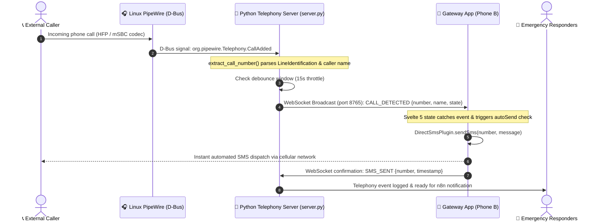
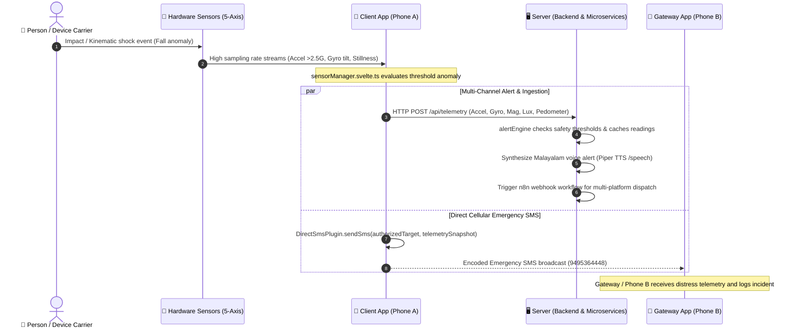
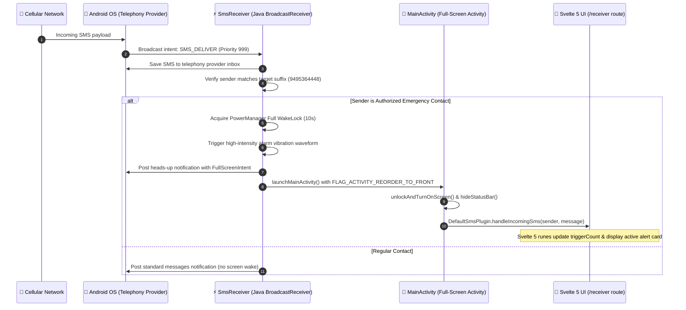

# realm-hack — RakshaNet Emergency Telemetry & Response Platform

> **Abstract**: An edge-aware emergency telemetry and rapid-response system combining real-time physical sensor detection with automated telephony gateways and localized speech microservices. Built with Capacitor 7, Svelte 5 (runes mode), Node.js, Linux PipeWire D-Bus telephony monitors, and Malayalam voice AI (TTS/ASR), the platform bridges on-device incident detection with automated dispatch and base-station notification channels for reliable emergency intervention.

## Project Description

**realm-hack** establishes an integrated emergency response loop split across three specialized components:

* **Client App (`client/`)** — Personal device application monitoring 5 hardware sensors (accelerometer, gyroscope, magnetometer, ambient light, pedometer). It evaluates kinematic thresholds to detect incidents/falls, packages live telemetry into emergency SMS broadcasts, and acts as a designated Android Default SMS Handler to execute full-screen wake locks, lockscreen dismissal, and continuous vibration alarms upon authorized triggers.
* **Gateway App (`gateway/`)** — Mobile base-station client that links with local telephony listeners via WebSockets. It detects incoming calls over Bluetooth hands-free profiles (HFP) in real time and automatically dispatches immediate SMS alerts to callers without requiring manual device interaction.
* **Server & Services (`server/`)** — Edge infrastructure hosting real-time telemetry ingestion and WebSocket distribution (`server/backend`), PipeWire/oFono telephony D-Bus monitors (`server/server.py`), localized Malayalam Piper TTS (`server/services/malayalam-tts`), Malayalam voice ASR (`server/services/malayalam-voice-asr`), and n8n workflow automation (`server/services/n8n`).

---

## Architecture

```
realm-hack/
├── client/                     # Sensor telemetry, fall detection & default SMS receiver
├── gateway/                    # Automated Bluetooth call monitor & quick-dial app
└── server/
    ├── backend/                # Telemetry ingestion & WebSocket streaming server
    ├── services/
    │   ├── malayalam-tts/      # Malayalam Piper Text-to-Speech container
    │   ├── malayalam-voice-asr/# Malayalam Speech Recognition model service
    │   └── n8n/                # n8n event orchestration workflows
    ├── server.py               # PipeWire Bluetooth call monitor & WebSocket server
    └── extract_call_number.py  # D-Bus telephony inspection CLI
```

---

## System Sequence Diagrams

The interactions between **Client (App)**, **Gateway (App)**, and **Server** are coordinated via cellular SMS, local WebSockets, D-Bus IPC, and HTTP REST APIs.

### 1. Hands-Free Telephony & Auto-Responder (`server.py` & Gateway)
When an incoming call is picked up via Bluetooth hands-free audio, the Python telephony server extracts caller metadata over Linux D-Bus and coordinates with the Gateway app over WebSockets for automatic SMS response.



---

### 2. Emergency Incident Detection & Server Telemetry Ingestion
When kinematics detect an emergency or fall anomaly, the Client app executes multi-channel alerting: syncing full 5-axis telemetry with the backend server while dispatching an emergency SMS payload to the Gateway.



---

### 3. Default SMS App Role & Emergency Alarm Wake Lock
When an incoming emergency trigger is received on an Android device running the Client app with the Default SMS role, it intercepts the message at highest priority, bypasses lockscreens, and sounds vibration alarms.



---

## Quick Start

### Client (App)
```bash
# Run web preview
npm run dev:client

# Build web assets
npm run build:client
```

### Gateway (App)
```bash
# Run web preview
npm run dev:gateway

# Build web assets
npm run build:gateway
```

### Server
```bash
# Run telemetry server
npm run dev:server

# Run Bluetooth telephony listener
python3 server/server.py
```
